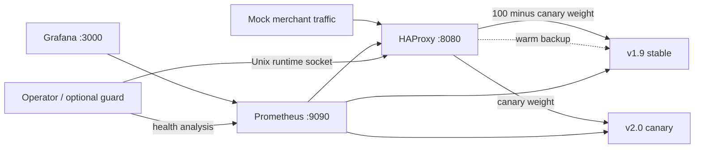
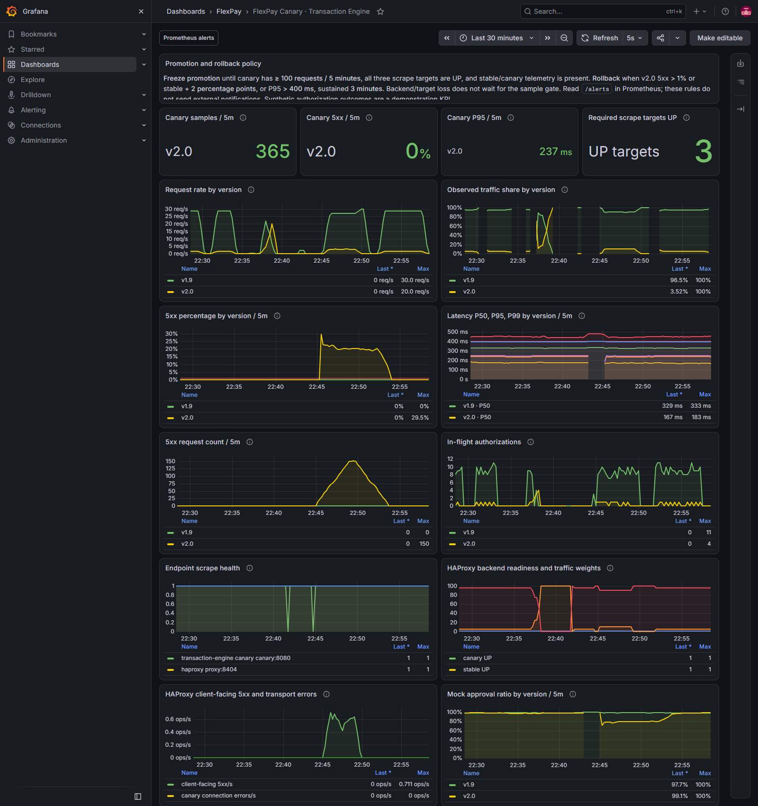

# FlexPay transaction-engine canary deployment

A local, reviewable implementation of a payment-service rollout: run v1.9 and v2.0 together, shift traffic without restarting the proxy, compare their metrics, and return new requests to v1.9 with one command. The application is a **mock**: it never contacts a payment provider or processes real money.

Core requirements are implemented with Docker Compose, HAProxy, a Python standard-library HTTP service, Prometheus and a provisioned Grafana dashboard. Stretch features include metric-gated promotion, optional automatic rollback, file-mounted secrets with request-time reload, and a Jenkins staging pipeline with manual approvals.

## Architecture



Only the API, Prometheus and Grafana are published, on **127.0.0.1**. Neither application version nor the privileged HAProxy control socket is exposed on the host. The operator has no Docker socket or cloud credentials. Published local ports are not suitable as a public submission URL; submit the public Git repository.

There are **two independent application containers**, `stable` (v1.9) and `canary` (v2.0), behind one API URL. A single `/health` response identifies the version selected for that request. `docker compose ps` shows both instances, and the dashboard separates their traffic. You can inspect each directly inside its container:

```bash
docker compose exec stable python -c "import urllib.request; print(urllib.request.urlopen('http://127.0.0.1:8080/version').read().decode())"
docker compose exec canary python -c "import urllib.request; print(urllib.request.urlopen('http://127.0.0.1:8080/version').read().decode())"
```

## Quick start

Requirements: a Linux Docker Engine, Docker Compose supporting `up --wait`, and approximately 2 GB free for images. On Windows 11 use Docker Desktop in Linux-container/WSL2 mode, or Docker Engine installed inside WSL2. A Windows `dockerd.exe` service alone cannot run these Linux images. Put your Docker image store and build cache on a drive with sufficient free space.

Windows PowerShell with Docker Desktop:

```powershell
git clone https://github.com/petergao87/flexpay-canary.git
cd flexpay-canary
./scripts/init-secrets.ps1
docker compose config --quiet
docker compose up -d --build --wait --wait-timeout 120
docker compose run --rm ops status
docker compose run --rm ops traffic 5
docker compose run --rm ops load --duration 300 --rps 30
```

Linux or WSL2 (run in the repository directory):

```bash
sh ./scripts/init-secrets.sh
docker compose config --quiet
docker compose up -d --build --wait --wait-timeout 120
docker compose run --rm ops status
docker compose run --rm ops traffic 5
docker compose run --rm ops load --duration 300 --rps 30
```

The proxy starts at **100% stable / 0% canary**. The explicit `traffic 5` command begins the initial 95/5 deployment after confirming readiness. A proxy restart resets to stable-only, so an earlier promotion or rollback is never silently replayed. A failed canary cannot prevent the stable proxy path from starting; `up --wait` can nevertheless report failure for an unhealthy canary, which is the correct signal to investigate rather than promote.

Inspect the API with a mock request:

```powershell
Invoke-RestMethod http://127.0.0.1:8080/authorize -Method Post -ContentType application/json -Body '{"amount":100,"currency":"USD","merchant_id":"demo-merchant","request_id":"demo-001"}'
```

```bash
curl -sS http://127.0.0.1:8080/authorize \
  -H 'Content-Type: application/json' -H 'Idempotency-Key: demo-001' \
  -d '{"amount":100,"currency":"USD","merchant_id":"demo-merchant","request_id":"demo-001"}'
```

Responses expose `version`, `simulated`, and the mock transaction result. `/health` checks readiness, `/version` identifies the selected version, and `/metrics` exposes per-version authorization metrics. The response explicitly disclaims durable state and real idempotency guarantees. Request keys produce deterministic mock identifiers; they do not prevent actual payment side effects.

## Deployment playbook

Keep v1.9 running at full rollback capacity throughout the rollout. The commands below operate only this local mock stack.

1. **Prepare.** Verify the known stable image, schema/API compatibility, valid secret mounts, available rollback capacity and an operator with authority to approve promotion. Start the stack and verify `ops status` reports both servers healthy. Confirm Prometheus targets are UP and the dashboard is populated.
2. **Start at 5%.** Run `docker compose run --rm ops traffic 5`. Generate representative traffic or keep the mock load generator running in a second terminal. Inspect version traffic shares and all errors, including proxy errors.
3. **Observe at 5–10%.** Hold each phase for at least five minutes and collect at least 100 canary requests within the five-minute window. Run `docker compose run --rm ops analyze`. Optionally move to `traffic 10` and observe again. A small or missing sample blocks promotion.
4. **Approve 25%.** Run `docker compose run --rm ops traffic 25 --approve`. The flag records an explicit local operator decision; the tool also rejects missing baseline data or unhealthy canary metrics. Continue observing for at least five minutes.
5. **Approve 50%.** Run `docker compose run --rm ops traffic 50 --approve`. Repeat analysis and inspect acquirer/market approval trends where real business telemetry exists.
6. **Approve 100%.** Run `docker compose run --rm ops traffic 100 --approve`. Keep the stable container alive as a warm backup. Once stable receives no new requests, use absolute canary SLOs; there is no fresh stable comparison. Complete a longer post-rollout observation before retiring the rollback target. This demo intentionally retains it.
7. **Rollback whenever necessary.** Run `docker compose run --rm ops rollback`. It restores stable weight 100 before setting canary weight 0 and verifies the result. Existing canary requests finish; they are never replayed on stable. Investigate before restarting the rollout.

Runtime weight updates take effect for new request assignments, without rebuilding containers or reloading HAProxy. The two server updates are sequential; a brief intermediate share is possible, but the operator avoids leaving both primary weights at zero. Round-robin percentages are approximate for a small request sample, and exclude servers that fail readiness. Concurrent operator changes are serialized by the shared control lock.

If the stable server is unhealthy, rollback fails visibly and preserves canary traffic instead of moving requests to a dead target. If the proxy/control socket is unavailable, the tool exits nonzero; restore proxy connectivity and use the documented stable-only startup behavior.

## Metrics and canary health

- Grafana: [FlexPay Canary · Transaction Engine](http://127.0.0.1:3000/d/flexpay-canary), user `admin`. Read the generated `.secrets/grafana_admin_password` locally to sign in; never paste it into a ticket, submission or logs. The dashboard is provisioned automatically.
- Prometheus targets: [http://127.0.0.1:9090/targets](http://127.0.0.1:9090/targets).
- Prometheus alerts: [http://127.0.0.1:9090/alerts](http://127.0.0.1:9090/alerts). Rules are evaluated every 15 seconds. Alertmanager/email/Slack delivery is not configured.
- CLI analysis: `docker compose run --rm ops analyze`. A healthy result requires adequate samples and valid measurements; missing metrics are not interpreted as zero errors.

The dashboard shows request rate, observed traffic share, 5xx percentage, P50/P95/P99, request counts, active requests, application target health and HAProxy transport/error signals. Latency histograms approximate quantiles; stable averages around 325 ms, and canary around 170 ms under the default mock delays. Error metrics cover `/authorize` requests and exclude readiness/metrics scrapes. Declines are business outcomes, separate from 5xx availability failures.

Actual local dashboard after restoring the healthy 95/5 baseline. The load generator had finished when this screenshot was captured, so latest RPS can return to zero while the historical healthy traffic remains visible. The [fault-drill screenshot](evidence/grafana-dashboard.png) separately shows the 20% error injection and automatic rollback.



| Gate | Action |
|---|---|
| At least 100 canary requests in the last 5 minutes; live stable baseline before promotion | Required to promote above 10% |
| Canary 5xx >1%, or >stable +2 percentage points, for 3 minutes | Rollback |
| Canary P95 >400 ms for 3 minutes | Rollback |
| Failed canary readiness or lost proxy-to-canary connectivity | HAProxy removes it after two checks; guard rolls back without sample gate |
| Missing telemetry or insufficient traffic | Freeze promotion and investigate |
| Stable unavailable | Freeze promotion; restore rollback capacity before changing traffic |

The 1% error limit is a rollout emergency threshold, not the final 99.9% availability SLO. A production error budget can require earlier action. The target canary P95 is below 300 ms; 400 ms is the stop threshold. The five-minute analysis window plus a three-minute sustained breach means metric-based rollback may take several minutes; health-check exclusion is much faster.

Useful PromQL (select a version label to focus a panel):

```promql
# Requests/second by version
sum by (version) (rate(transaction_requests_total[1m]))

# Error fraction by version, retaining a zero series when no 5xx exist
(sum by (version) (rate(transaction_requests_total{status=~"5.."}[5m]))
 or on (version) (0 * sum by (version) (rate(transaction_requests_total[5m]))))
 / clamp_min(sum by (version) (rate(transaction_requests_total[5m])), 0.000000001)

# P95 (change 0.95 to 0.50 or 0.99)
histogram_quantile(0.95, sum by (version, le)
  (rate(transaction_request_duration_seconds_bucket[5m])))

# Actual canary traffic share
100 * sum(rate(transaction_requests_total{version="v2.0"}[1m]))
 / sum(rate(transaction_requests_total[1m]))
```

## Optional automatic rollback

```bash
# Observe without changing traffic
docker compose run --rm ops watch
# Start the supervised guard, which never auto-promotes
docker compose --profile automation up -d guard
# Inspect analysis/actions and stop automation after the rollout
docker compose logs -f guard
docker compose --profile automation stop guard
```

The guard polls every 15 seconds, requires the sample gate for metric breaches, and holds a bad condition for three minutes before rollback. Failed canary backend health uses the faster availability path. At 0% it does not evaluate absent canary traffic as a failure. At 100% it uses absolute thresholds without demanding a new stable sample. Loss of Prometheus visibility freezes decisions and emits a warning; the guard still checks backend availability where possible. Keep a human on-call during a rollout.

## Demonstrate failure handling

Use the following only in this mock environment. Stop the automatic guard while testing manual behavior, or expect it to change weights.

```bash
# Inject 20% errors without replacing the stable or proxy container
CANARY_ERROR_RATE=0.2 docker compose up -d --no-deps --force-recreate canary
docker compose run --rm ops traffic 10
docker compose run --rm ops load --duration 300 --rps 30
docker compose run --rm ops analyze       # unhealthy; exits nonzero
docker compose run --rm ops rollback
CANARY_ERROR_RATE=0 docker compose up -d --no-deps --force-recreate canary

# Crash/unavailability: active health checks remove canary
docker compose stop canary
docker compose run --rm ops status
docker compose start canary
```

PowerShell equivalent for the error override:

```powershell
$env:CANARY_ERROR_RATE='0.2'
docker compose up -d --no-deps --force-recreate canary
# Restore after rollback
$env:CANARY_ERROR_RATE='0'
docker compose up -d --no-deps --force-recreate canary
Remove-Item Env:CANARY_ERROR_RATE
```

Changing canary environment variables requires recreating **only canary**. Route it to 0% first, wait until its inflight metric is zero, and then replace it for an actual safe rollout. The failure drill deliberately removes it while traffic is assigned to demonstrate bounded failure detection. A true network partition is described in [DESIGN_DECISIONS.md](DESIGN_DECISIONS.md); readiness failure is not identical to a partition, and in-flight requests can fail during either event.

## Secrets and shutdown

The initialization scripts generate random **mock-only** credentials, preserve existing files, and hide their values. `.secrets/` and `.env` are excluded from Git and the image build context. Database/provider file paths and log level are environment based; sensitive values are mounted under `/run/secrets`. Applications run as UID 10001 with a read-only root filesystem.

For Linux Compose file mounts, source files must be readable by the container UID. The Linux bootstrap uses readable files inside a host directory restricted to the operator; Compose does not provide an encrypted secret store. Use Vault/cloud secret management and workload identities in production. The Windows script restricts the host directory ACL to the operator and SYSTEM.

The mock rereads credential files on each authorization and readiness check. **Overwrite the existing file in place**, preserving its inode; replacing/renaming a source file can leave Compose's single-file bind mount pointing at the old content. Do this only with generated mock data in the demo. Empty/unreadable credentials cause readiness503; a rotation requires overlap and verification for real payment credentials. Grafana's administrator password is a startup setting, so its file is not a hot-rotation demonstration.

On SIGTERM the engine refuses new admissions, marks readiness false, closes the listening server and waits for request threads to complete. Compose allows 15 seconds before SIGKILL; typical work is below 500 ms. Before intentionally stopping an instance, first drain its proxy weight and wait for active work to reach zero. Do not use `docker compose down` during a live rollout. A proxy restart is a separate maintenance event; one local proxy cannot promise high availability.

## Validation and CI/CD

See [evidence/VALIDATION.md](evidence/VALIDATION.md) for actual checks and limitations from this delivery. Local Python tests need no third-party application dependencies:

```bash
PYTHONDONTWRITEBYTECODE=1 python -B -m unittest discover -s tests -v
docker compose run --rm --entrypoint haproxy proxy -c -f /usr/local/etc/haproxy/haproxy.cfg
docker compose exec prometheus promtool check config /etc/prometheus/prometheus.yml
docker compose exec prometheus promtool check rules /etc/prometheus/alerts.yml
```

HTTP integration tests are opt-in; see the header in `tests/test_integration.py` for the environment flag. They target the mock only. For this project Peter approved local static, unit, build and integration validation before execution. Follow your own approval requirements before rerunning tests.

[Jenkinsfile](Jenkinsfile) defines a dedicated staging pipeline: manual validation approval, image build, Dockerfile linting, unit/API validation, Trivy scanning, canary-only deployment, initial 5% rollout, and a separate manual gate before increasing beyond 10%. It requires a prepared dedicated Linux Docker agent, an already-running stable stack and secure secret files. The default project is `flexpay-canary-staging`; see [monitoring/README.md](monitoring/README.md) for bootstrap and the three Jenkins file-credential IDs. Production deployment is intentionally not connected. The `--approve` CLI flag is an operator acknowledgement rather than an access-control boundary; Jenkins authorization and agent isolation provide the real approval boundary.

## Repository guide

| Path | Purpose |
|---|---|
| `compose.yaml` | Two versions, proxy, monitoring and optional guard |
| `app/` | Mock service and non-root Dockerfile |
| `proxy/` | HAProxy Dockerfile, readiness checks, weights, warm backup |
| `scripts/` | Runtime operator, bounded mock load generator and secret initialization |
| `monitoring/` | Prometheus scrape/alert rules and Grafana dashboard/provisioning |
| `tests/` | Service, operator and opt-in HTTP validation |
| `DESIGN_DECISIONS.md` | Design trade-offs and payment failure reasoning |
| `evidence/VALIDATION.md` | Actual validation evidence |
| `SUBMISSION.md` | Submission fields and concise evaluator notes |

Stop the mock environment when finished: `docker compose --profile automation stop`. `docker compose down` removes containers and networks but preserves named volumes; add `--volumes` only if you deliberately want to delete local metrics/Grafana data.
